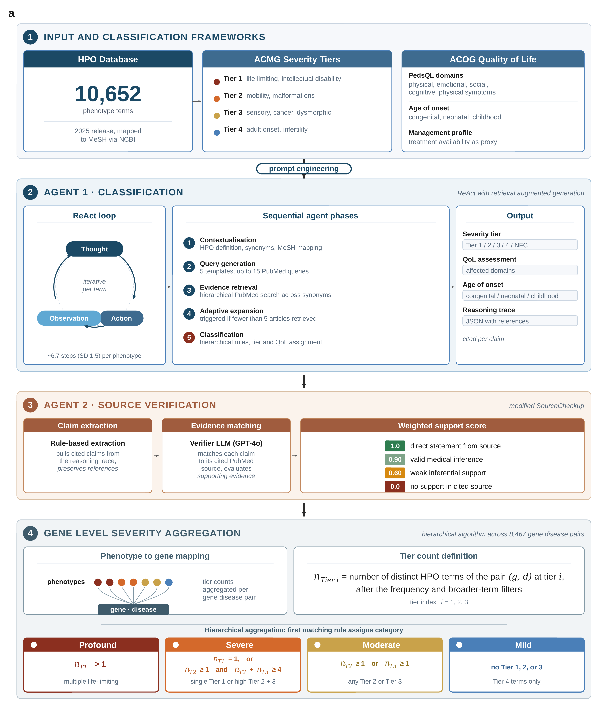

# HPO severity classification agent

Code, data and saved outputs for the manuscript "Large Language Model Agents for Evidence Based Genetic Disease Severity Classification".

The agent classifies Human Phenotype Ontology (HPO) terms into the clinical severity tiers of Lazarin et al. (Tiers 1 to 4) and into quality-of-life domains based on the PedsQL. For each term it reads the HPO record, maps the term to a MeSH heading, searches PubMed, and asks a language model (GPT-4o) to choose a category and the affected quality-of-life domains, with a quote and a reference for every factual claim. The tier follows from the category and the quality-of-life rating. A second agent then checks each cited claim against its source and gives the classification a support score. The phenotype classes are finally aggregated to gene-disease pairs and compared with clinical gene lists.



*Workflow (Figure 1 of the manuscript).*

| Part | Manuscript | Code |
|---|---|---|
| Classification agent and verification agent | Figure 1, Methods | `hpo_severity/agent.py` |
| Model selection | Figure S1 | `hpo_severity/model_selection.py`, `prompts/model_selection/` |
| Validation against expert labels, no-retrieval baseline | Figure 2, Figure S3 | `hpo_severity/baseline.py`, `hpo_severity/figures.py`, `prompts/baseline/` |
| Phenotype-level analyses of all classified terms | Figures 3 to 6, Figure S2, Table 1, Supplementary Table 2 | `hpo_severity/figures.py` |
| Gene-disease table and gene-level severity | Figure 7, Table 2 | `hpo_severity/gene_table.py`, `hpo_severity/gene_level.py` |
| Check of every number in the manuscript | all | `hpo_severity/verify.py`, `hpo_severity/manuscript_numbers.py` |

## System requirements

- Linux, macOS or Windows with Python 3.13. Tested on Ubuntu 24.04 (x86-64) with Python 3.13.18 and the package versions in `requirements.txt`; `docs/tested_environment.txt` lists every installed package. The GitHub Actions workflow runs the tests on Ubuntu 24.04.
- About 4 GB of memory (`run.py verify` peaked at 3.2 GB) and 1 GB of free disk space (the data files are unpacked on first use). No GPU.
- Optional: Arial or Helvetica for the figure text. Without them the figures use Liberation Sans, which has the same letter widths (see Figures below).
- An OpenRouter API key and an email address for NCBI only for the commands that call the language model (`classify`, `baseline`, `model-selection`, and `demo` when it classifies).
- For `classify` and `demo` only: the packages in `requirements-agent.txt` (FAISS, sentence-transformers and rank-bm25) and the index of HPO term records (`--index`, a folder with `docs.faiss`, `bm25.pkl` and `documents.pkl`).

## Install

```shell
git clone https://github.com/T0hid/severity-hpo-classification.git
cd severity-hpo-classification
python -m venv .venv
source .venv/bin/activate        # Windows: .venv\Scripts\activate
python -m pip install -r requirements.txt
```

Or with Docker:

```shell
docker build -t severity-hpo-classification .
docker run --rm -v "$PWD:/work" severity-hpo-classification python run.py verify
```

Installing the packages with pip took 32 seconds in a new virtual environment with no pip cache. Building the Docker image took about 1 minute, plus the download of the `python:3.13-slim` base image. In Docker, `run.py verify` took about 2 minutes and the tests about 8 seconds.

## Check the published results (no API key)

These commands use the saved outputs of the run reported in the paper (`published_run/`). They call no language model. Each writes to a new folder under `outputs/`.

| Command | What it does | Time |
|---|---|---|
| `python run.py verify` | Unpacks the data and checks every file against its SHA-256; scores the agent and the baseline against the ground truth; rebuilds the gene-disease table from the inputs and checks that it is identical to the published one; redraws the figures; recomputes 493 numbers of the manuscript and reports PASSED or FAILED for each. Report: `outputs/verify/verify_report.md`. | about 2 minutes |
| `python run.py figures` | Redraws Figures 2 to 7 and S1 to S3 and writes the validation and analysis reports. Add `--rebuild-gene-table` to rebuild the gene-disease table from the inputs first. | about 1 minute |
| `python -m pytest tests` | Unit tests, including checks that the prompts are unchanged and that the baseline prompt is the agent's classification prompt without the sources. | about 10 seconds |

## Demo

```shell
export OPENROUTER_API_KEY=...      # see .env.example
export NCBI_EMAIL=you@example.org
python run.py demo
```

The demo classifies three terms from the validation set and prints the expert label, the saved classification of the published run and the new classification. Without an API key it prints the saved classifications only (a few seconds). Expected output:

```text
    hpo_id                    name                                   expert                                saved run
HP:0001249 Intellectual disability         Intellectual disability / tier 1         Intellectual disability / tier 1
HP:0002414            Spina bifida Internal physical malformations / tier 2 Internal physical malformations / tier 2
HP:0000574           Thick eyebrow              Dysmorphic feature / tier 4              Dysmorphic feature / tier 4
```

With a key, a column `this run` is added. A new run can differ from the saved one (see below). The demo costs about USD 0.30.

## New runs (API key needed)

| Command | What it does |
|---|---|
| `python run.py classify --input terms.csv` | Runs the agent on the HPO terms in a CSV file with an `hpo_id` column. `--index` gives the folder of the HPO record index; `--limit N` classifies N terms; `--hpo-release` chooses the HPO release the agent reads. A stopped run continues where it left off. |
| `python run.py baseline` | Classifies the 898 ground-truth terms with no retrieved literature, then scores the baseline and the agent. `--dry-run` writes one prompt without calling the model. |
| `python run.py model-selection` | Reruns the model selection of Figure S1 (GPT-5, Grok-4, Gemini-2.5-pro, Claude-3.5-sonnet, GPT-4o and GPT-4o-mini, each at 3 temperatures and 3 top-p values, on 14 terms). |

## Where each result comes from

`outputs/verify/verify_report.md` lists all 493 checked numbers one by one, each with the manuscript value, the recomputed value and the output it comes from.

The figures and tables are drawn by:

| Manuscript item | Output file (under the `figures` or `verify` output folder) | Code |
|---|---|---|
| Figure 1, Figure S4 | drawings, not code output | |
| Figure 2 (A to F), validation metrics in Results | `main/Figure2_validation.pdf`, `data_and_reports/validation_report_Figure2.txt`, `data_and_reports/validation_terms_scored.csv` | `figures.py` (Part 2) |
| Agent against baseline (Results, Figure 2E, F) | `_work/baseline/scores.csv`, `_work/baseline/per_term_results.csv` | `baseline.py` (`score`) |
| Figure 3 | `main/Figure3_clinical_landscape.pdf`, `data_and_reports/analysis_report_Figures3to6_S2_S3.txt` (sections 1 and 2) | `figures.py` |
| Figure 4 | `main/Figure4_evidence_quality.pdf`, analysis report section 3 | `figures.py` |
| Figure 5, Table 1 | `main/Figure5_QoL_domains.pdf`, analysis report section 4, `data_and_reports/phenotype_table_Figures3to6_S2.csv` | `figures.py`; shares by category in `manuscript_numbers.py` |
| Figure 6 | `main/Figure6_management_complexity.pdf`, analysis report section 6, `data_and_reports/phenotype_table_Figures3to6_S2.csv` | `figures.py` |
| Figure 7, Table 2, gene-list comparison | `main/Figure7_gene_level.pdf`, `data_and_reports/figure7_data.xlsx` | `gene_table.py`, `gene_level.py` |
| Exact P values (Results, Methods) | `data_and_reports/exact_p_values.csv` | `exact_p.py`, called from `figures.py` |
| Gene-disease pair counts (Results, gene level) | log of `gene_table.py` (`outputs/verify/work/logs/gene.log`) | `gene_table.py` |
| Figure S1 | `supplementary/FigureS1_model_selection.pdf` | `figures.py` (Part 1), from `published_run/model_selection_summary.csv` |
| Figure S2, Supplementary Table 2 | `supplementary/FigureS2_QoL_status_management.pdf`, analysis report section 5, `data_and_reports/phenotype_table_Figures3to6_S2.csv` | `figures.py`; intervention shares by QoL status in `manuscript_numbers.py` |
| Figure S3 | `supplementary/FigureS3_PSI_confusion_support_efficiency.pdf`, analysis report sections 7 and 10 | `figures.py` |
| Supplementary Table 1 (category definitions) | the category definitions in `create_final_classification_prompt()` | `agent.py` |

## Figures

`run.py figures` and `run.py verify` draw every figure at Nature Communications print size with `hpo_severity/style.py`: 180 mm wide, text 5.5 to 7.5 pt, lines scaled to the figure, Arial (or Helvetica; where neither is installed, Liberation Sans, which has the same letter widths, so the layout is the same). Each figure is written as a vector PDF with the fonts embedded as TrueType and as a 300 dpi PNG. Figure 2 and Supplementary Figure S3 are each drawn as one vector figure. Colour maps and bar colours are colour-blind safe. Figure 6A's shaded confidence band comes from a seeded bootstrap (`seed=42`), so it is the same on every run. The data in the figures do not depend on the fonts, and `run.py verify` checks the numbers, not the pixels.

P values are exact. Several are below the smallest number a float can hold, so `hpo_severity/exact_p.py` computes log10 P on the log scale with the same test and approximation as scipy, and `run.py figures` writes every test with its P value to `data_and_reports/exact_p_values.csv`.

## The language model

- Model: `openai/gpt-4o` through OpenRouter, which served the `gpt-4o-2024-11-20` snapshot. Temperature 0.2 for every call of the agent, the verification agent and the baseline. Other sampling settings are left at the provider defaults.
- Prompts: the agent's prompts are built in `hpo_severity/agent.py`; the baseline and model-selection prompts are files in `prompts/` (see `prompts/README.md`).
- Retrieval: the planner takes at most 12 steps per term. The agent maps the term to a MeSH heading and asks the model for common clinical names of the phenotype; with the HPO synonyms and the MeSH heading these give up to 15 queries. The queries search a local index of HPO term records (PubMedBERT embeddings with FAISS, and BM25), and the best record with a score of at least 0.75 is the first source. PubMed is then searched with the MeSH heading and the term's name and synonyms, first with a genetic-context filter and then without it, until a search returns articles (up to 20 PubMed IDs); the first 10 abstracts longer than 100 characters are kept. With fewer than 5 sources, or fewer than 3 at the classification step, the model lists related genetic syndromes, which are added to the queries, and the searches are run again.
- Classification: the model returns the category, the affected PedsQL domains and its reasoning in one reply. A term is rated Severe when at least one domain is affected or when its category is a Tier 1 or Tier 2 category. A Severe term takes the tier of its category and a Non-Severe term Tier 4; Out of Scope and NFC terms get no tier.
- Verification: sentences ending in a `[Ref #]` tag are taken from the conclusion and from the functional impact and severity sections of the reasoning, leaving out the agent's own classification statements, and the model rates each against its cited source as direct (weight 1.0), valid inference (0.90), weak inference (0.60) or unsupported (0); a claim that cites a reference that does not exist is unsupported. The support score is the mean weight. A classification is flagged for review when its score is below 0.5.
- HPO releases: 10,211 of the 10,652 terms were classified with HPO release 2025-05-06 and the other 441 with HPO release 2026-09-01. The column `hpo_release` of `published_run/agent_classifications.zip` gives the release of each term. `run.py classify` reads HPO release 2025-05-06 by default; `--hpo-release 2026-09-01` gives the setting of the 441 terms.
- Rerunning: a new run will not give identical output. The model can change behind the same name, PubMed grows, and sampling at temperature 0.2 is not deterministic. The saved outputs in `published_run/` are the reference for every number in the paper; `run.py verify` recomputes the numbers from them.

## Cost and time of a full rerun

The published run used 202.9 million input and 56.6 million output tokens for the 10,652 terms, about USD 1,073 at the prices in `.env.example` (USD 2.50 and 10 per million input and output tokens), or about USD 0.10 per term. The baseline (898 terms, one call each) and the model selection cost much less.

## Data

`data/README.md` lists every input file with its source, release and licence. `published_run/README.md` describes the saved outputs and their columns. `run.py` checks every file against `data/checksums.json` (SHA-256) before use.

## Tests

`python -m pytest tests` runs without an API key. The GitHub Actions workflow (`.github/workflows/check.yml`) runs the tests, `run.py verify` and `run.py figures` on every push and keeps the outputs as an artifact.

## Licence and citation

Code: MIT licence (`LICENSE`). Third-party data keep their own licences (`data/README.md`). If you use this code, please cite the article (see `CITATION.cff`).
